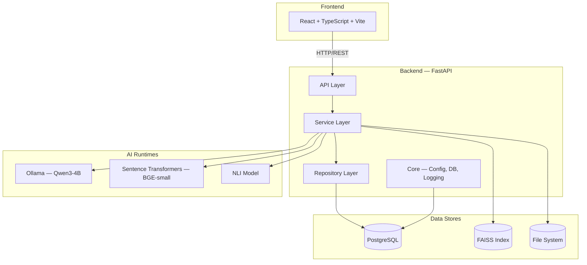
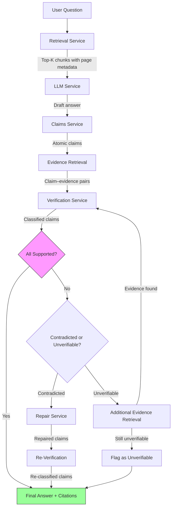
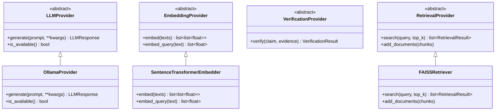
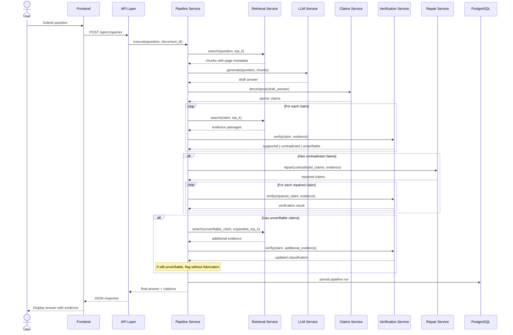
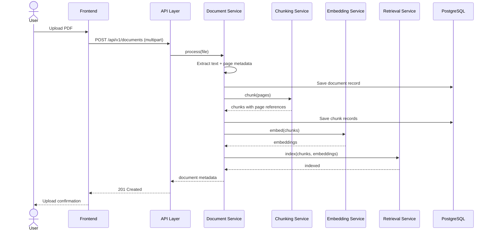

# System Architecture

## 1. Architecture Overview

The system follows a **modular monolith** architecture. All components are deployed as a single backend application, but are organized into well-defined modules with explicit boundaries. This allows future extraction into separate services if needed, without requiring a microservices overhead during development.



## 2. Backend Layer Responsibilities

| Layer | Package | Responsibility |
|-------|---------|----------------|
| **API** | `app.api` | HTTP route handlers. Request validation, response serialization. No business logic. |
| **Schemas** | `app.schemas` | Pydantic models for request/response contracts and internal data transfer. |
| **Services** | `app.services` | Business logic and pipeline orchestration. Coordinates between models, repositories, and external runtimes. |
| **Repositories** | `app.repositories` | Data access. All database queries are isolated here. |
| **Models** | `app.models` | SQLAlchemy ORM model definitions. |
| **Core** | `app.core` | Configuration, database engine, logging, shared utilities. |

### Layer Dependencies

```
API → Schemas, Services
Services → Schemas, Repositories, Models, Core, AI Providers
Repositories → Models, Core
Models → Core (Base)
```

Services never import from API. Repositories never import from Services. Models never import from Repositories.

## 3. Service Boundaries (Planned)

Each service module encapsulates a distinct capability. Services communicate through Python function calls within the monolith. Each service defines an interface (abstract base class) and at least one concrete implementation.

| Service | Responsibility | Key Interfaces |
|---------|---------------|----------------|
| `documents` | PDF upload, text extraction, page metadata preservation. | `DocumentProcessor` |
| `chunking` | Page-boundary-respecting text chunking (chunks do not cross page breaks for MVP). Configurable strategy. | `ChunkingStrategy` |
| `embeddings` | Text embedding via sentence transformers. Model-agnostic. | `EmbeddingProvider` |
| `retrieval` | Vector similarity search. Backend-agnostic (FAISS initially). | `RetrievalProvider` |
| `llm` | Text generation. Provider-agnostic (Ollama initially). | `LLMProvider` (implemented) |
| `claims` | Claim decomposition from generated text. | `ClaimDecomposer` |
| `verification` | NLI-based claim–evidence verification. | `VerificationProvider` |
| `repair` | Targeted evidence-grounded repair of problematic claims. | `RepairStrategy` |
| `pipeline` | End-to-end orchestration: query → retrieval → generation → verification → repair → response. | `PipelineOrchestrator` |

> **Note:** These service modules will be created incrementally as each milestone requires them. Empty placeholder modules are not created preemptively.

## 4. AI Pipeline Data Flow



### Stage Details

| Stage | Input | Output | Model/Component |
|-------|-------|--------|-----------------|
| Retrieval | User question | Top-K chunks with page metadata | FAISS + BGE-small embeddings |
| Generation | Question + retrieved chunks | Draft answer text | Qwen3-4B via Ollama |
| Claim Decomposition | Draft answer | List of atomic claims | Qwen3-4B (structured prompt) |
| Evidence Retrieval | Each atomic claim | Relevant evidence passages per claim | FAISS + BGE-small |
| Verification | Claim–evidence pairs | Label per claim: supported / contradicted / unverifiable | Dedicated NLI model |
| Repair | Contradicted claims + evidence | Repaired claim text | Qwen3-4B (evidence-constrained prompt) |
| Unverifiable Handling | Unverifiable claims | Additional evidence retrieval; flag if still unverifiable | FAISS + BGE-small; no fabrication |
| Re-Verification | Repaired claim–evidence pairs | Label per repaired claim | Dedicated NLI model |
| Assembly | All verified/repaired claims + evidence | Final answer with per-claim citations | Deterministic assembly |

## 5. Model Abstraction Strategy

All AI models are accessed through abstract interfaces. The application depends on the interface, not on a specific model or runtime.



This design allows:
- Swapping Ollama for another LLM runtime (llama.cpp, vLLM, remote API) by implementing `LLMProvider`.
- Swapping BGE-small for another embedding model by implementing `EmbeddingProvider`.
- Swapping FAISS for another vector store (pgvector, Chroma) by implementing `RetrievalProvider`.
- Swapping the NLI model by implementing `VerificationProvider`.

## 6. Failure Handling

| Failure | Handling Strategy |
|---------|-------------------|
| Ollama unavailable | Health check detects unavailability. Generation requests return a clear error. System does not crash. |
| NLI model unavailable | Verification returns an error status. Claims are not silently marked as supported. |
| PDF extraction failure | Return error with filename. Do not silently skip pages. |
| FAISS index not found | Return error indicating no documents are indexed. |
| Database connection failure | Lazy engine initialization. Health endpoint remains available without database. |
| Claim decomposition produces no claims | Return the draft answer flagged as "unverified". |
| Repair introduces new unsupported claims | Re-verification catches new issues. Pipeline caps repair iterations to prevent loops. |

## 7. Scalability Considerations

The MVP targets single-user, small-document-collection scenarios. The architecture supports future scaling:

| Concern | MVP Approach | Future Path |
|---------|-------------|-------------|
| Vector store | In-process FAISS | pgvector or managed vector database |
| Document Scoping | Post-retrieval DB filtering (10x over-fetch from FAISS) | Advanced IDSelectorBatch or pgvector metadata filtering |
| LLM serving | Local Ollama on RTX 2050 (4 GB VRAM) | Dedicated GPU server or cloud inference |
| Document storage | Local filesystem | Object storage (S3-compatible) |
| Concurrency | Single worker process | Multiple workers; async I/O throughout |
| Pipeline execution | Synchronous orchestration | Task queue (Celery/similar) for long pipelines |
| Model memory | Sequential loading or CPU/GPU separation (4 GB VRAM constraint) | Dedicated GPU with sufficient VRAM for concurrent loading |

## 8. Request Lifecycle (Question Answering)



## 9. Document Upload Lifecycle



## 10. Cross-References

- API contracts: [API_SPECIFICATION.md](API_SPECIFICATION.md)
- Database schema: [DATABASE_DESIGN.md](DATABASE_DESIGN.md)
- Model selection rationale: [MODEL_SELECTION.md](MODEL_SELECTION.md)
- ADR on LLM selection: [adr/001-llm-selection.md](adr/001-llm-selection.md)
- ADR on vector store: [adr/002-vector-store.md](adr/002-vector-store.md)
- ADR on verification strategy: [adr/003-verification-strategy.md](adr/003-verification-strategy.md)
- ADR on repair strategy: [adr/004-repair-strategy.md](adr/004-repair-strategy.md)
