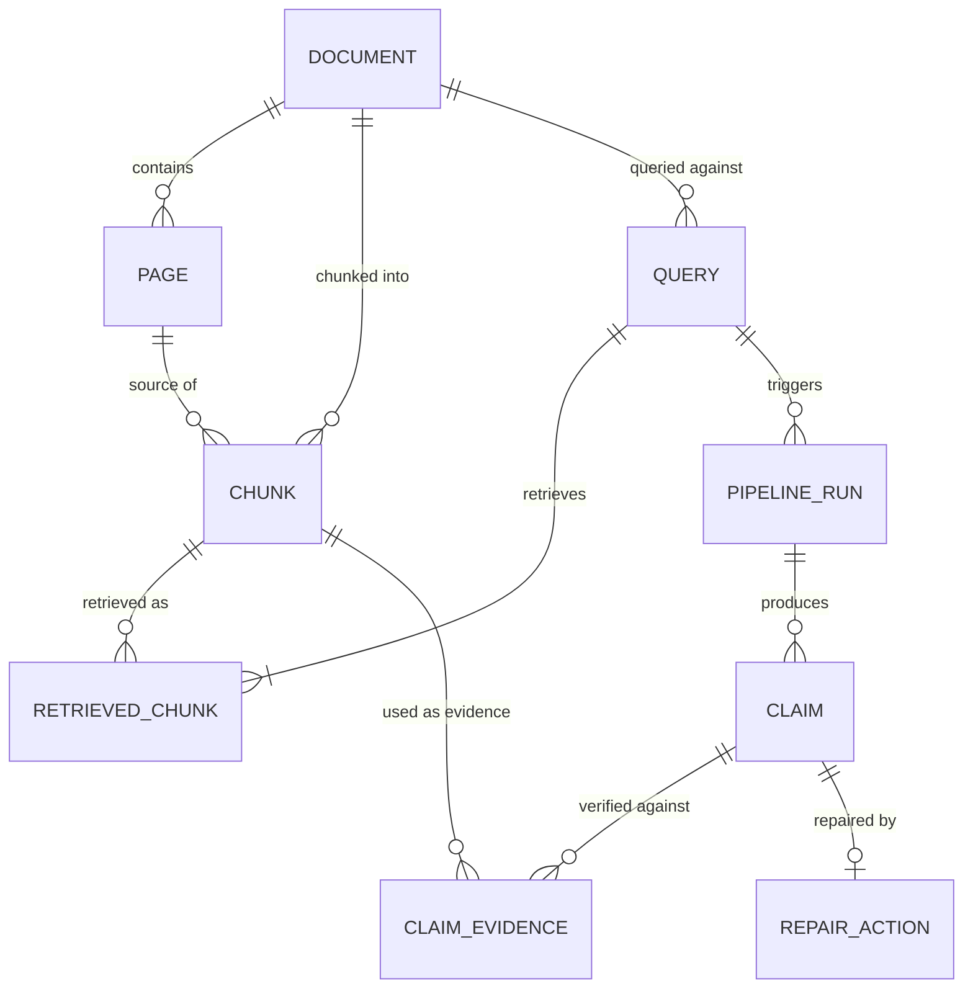

# Database Design

> **Status:** Proposed. No tables have been created via migration yet. The only implemented database infrastructure is the SQLAlchemy async engine and session management in `app/core/database.py`.

## 1. Entity Relationship Diagram

## 2. Proposed Entities

### 2.1 `documents`

Stores metadata for uploaded PDF files.

| Column | Type | Constraints | Description |
|--------|------|-------------|-------------|
| `id` | UUID | PK, default gen | Primary key. |
| `title` | VARCHAR(500) | NOT NULL | Display title (defaults to filename). |
| `filename` | VARCHAR(500) | NOT NULL | Original uploaded filename. |
| `file_path` | VARCHAR(1000) | NOT NULL | Path to stored file on disk. |
| `file_size_bytes` | BIGINT | NOT NULL | File size in bytes. |
| `page_count` | INTEGER | NOT NULL | Number of pages extracted. |
| `status` | VARCHAR(50) | NOT NULL, default 'pending' | Processing status: `pending`, `processing`, `processed`, `failed`. |
| `error_message` | TEXT | NULLABLE | Error details if processing failed. |
| `created_at` | TIMESTAMPTZ | NOT NULL, default now | Upload timestamp. |
| `updated_at` | TIMESTAMPTZ | NOT NULL, default now | Last update timestamp. |

**Indexes:** `ix_documents_status`, `ix_documents_created_at`.

---

### 2.2 `pages`

Stores per-page extracted text with page numbers.

| Column | Type | Constraints | Description |
|--------|------|-------------|-------------|
| `id` | UUID | PK, default gen | Primary key. |
| `document_id` | UUID | FK → documents.id, NOT NULL | Parent document. |
| `page_number` | INTEGER | NOT NULL | 1-indexed page number. |
| `text_content` | TEXT | NOT NULL | Extracted text for this page. |
| `text_length` | INTEGER | NOT NULL | Character count. |
| `created_at` | TIMESTAMPTZ | NOT NULL, default now | Extraction timestamp. |

**Indexes:** `ix_pages_document_id`, unique constraint on `(document_id, page_number)`.

---

### 2.3 `chunks`

Stores text chunks with page provenance.

| Column | Type | Constraints | Description |
|--------|------|-------------|-------------|
| `id` | UUID | PK, default gen | Primary key. |
| `document_id` | UUID | FK → documents.id, NOT NULL | Parent document. |
| `page_start` | INTEGER | NOT NULL | Starting page number (same as page_end for MVP since chunks do not cross page boundaries). |
| `page_end` | INTEGER | NOT NULL | Ending page number (same as start for MVP; may differ if cross-page chunking is enabled experimentally). |
| `chunk_index` | INTEGER | NOT NULL | Order within the document. |
| `text_content` | TEXT | NOT NULL | Chunk text. |
| `text_length` | INTEGER | NOT NULL | Character count. |
| `faiss_index_id` | INTEGER | NULLABLE | FAISS vector index position. Maps deterministically to this chunk record via persisted index metadata. |
| `created_at` | TIMESTAMPTZ | NOT NULL, default now | Creation timestamp. |

**Indexes:** `ix_chunks_document_id`, `ix_chunks_faiss_index_id`.

**Note:** Embedding vectors are stored in FAISS, not in PostgreSQL. The `faiss_index_id` column stores the integer index position within the FAISS index. A persisted index metadata file maintains the bidirectional mapping between FAISS index positions and PostgreSQL chunk UUIDs, ensuring deterministic reconstruction after application restart.

---

### 2.4 `queries`

Stores user questions and configuration.

| Column | Type | Constraints | Description |
|--------|------|-------------|-------------|
| `id` | UUID | PK, default gen | Primary key. |
| `question` | TEXT | NOT NULL | User's natural language question. |
| `document_ids` | UUID[] | NOT NULL | Target document IDs. |
| `top_k` | INTEGER | NOT NULL, default 5 | Retrieval parameter. |
| `mode` | VARCHAR(50) | NOT NULL, default 'full' | `full` (with verification/repair) or `baseline` (standard RAG). |
| `created_at` | TIMESTAMPTZ | NOT NULL, default now | Query timestamp. |

**Indexes:** `ix_queries_created_at`.

---

### 2.5 `pipeline_runs`

Records the execution of the full pipeline for a query.

| Column | Type | Constraints | Description |
|--------|------|-------------|-------------|
| `id` | UUID | PK, default gen | Primary key. |
| `query_id` | UUID | FK → queries.id, NOT NULL | Associated query (not unique — multiple runs per query are allowed for experiments). |
| `draft_answer` | TEXT | NULLABLE | Raw LLM output before verification. |
| `final_answer` | TEXT | NULLABLE | Answer after verification and repair. |
| `total_claims` | INTEGER | default 0 | Total decomposed claims. |
| `supported_claims` | INTEGER | default 0 | Claims classified as supported. |
| `contradicted_claims` | INTEGER | default 0 | Claims classified as contradicted. |
| `unverifiable_claims` | INTEGER | default 0 | Claims classified as unverifiable. |
| `repaired_claims` | INTEGER | default 0 | Claims that underwent repair. |
| `total_duration_ms` | INTEGER | NULLABLE | End-to-end pipeline duration. |
| `status` | VARCHAR(50) | NOT NULL, default 'pending' | `pending`, `running`, `completed`, `failed`. |
| `error_message` | TEXT | NULLABLE | Error details if failed. |
| `generation_model` | VARCHAR(200) | NULLABLE | Model name/version used for generation. |
| `embedding_model` | VARCHAR(200) | NULLABLE | Model name/version used for embeddings. |
| `verification_model` | VARCHAR(200) | NULLABLE | Model name/version used for NLI verification. |
| `chunk_size` | INTEGER | NULLABLE | Chunk size parameter used. |
| `chunk_overlap` | INTEGER | NULLABLE | Chunk overlap parameter used. |
| `top_k` | INTEGER | NULLABLE | Retrieval top-K parameter used. |
| `repair_iteration_limit` | INTEGER | NULLABLE | Maximum repair iterations configured. |
| `config_snapshot` | JSONB | NULLABLE | Full configuration snapshot for reproducibility (prompt versions, additional parameters). |
| `created_at` | TIMESTAMPTZ | NOT NULL, default now | Execution start. |
| `completed_at` | TIMESTAMPTZ | NULLABLE | Execution end. |

**Indexes:** `ix_pipeline_runs_query_id`, `ix_pipeline_runs_status`.

---

### 2.6 `pipeline_stages`

Records per-stage timing and status within a pipeline run.

| Column | Type | Constraints | Description |
|--------|------|-------------|-------------|
| `id` | UUID | PK, default gen | Primary key. |
| `pipeline_run_id` | UUID | FK → pipeline_runs.id, NOT NULL | Parent run. |
| `stage_name` | VARCHAR(100) | NOT NULL | Stage identifier: `retrieval`, `generation`, `claim_decomposition`, `verification`, `repair`, `re_verification`. |
| `stage_order` | INTEGER | NOT NULL | Execution order. |
| `status` | VARCHAR(50) | NOT NULL | `completed`, `failed`, `skipped`. |
| `duration_ms` | INTEGER | NULLABLE | Stage duration in milliseconds. |
| `output_summary` | TEXT | NULLABLE | Brief human-readable summary of output. |
| `created_at` | TIMESTAMPTZ | NOT NULL, default now | Stage start. |

**Indexes:** `ix_pipeline_stages_pipeline_run_id`.

---

### 2.7 `retrieved_chunks`

Maps which chunks were retrieved for a query.

| Column | Type | Constraints | Description |
|--------|------|-------------|-------------|
| `id` | UUID | PK, default gen | Primary key. |
| `query_id` | UUID | FK → queries.id, NOT NULL | Associated query. |
| `chunk_id` | UUID | FK → chunks.id, NOT NULL | Retrieved chunk. |
| `similarity_score` | FLOAT | NOT NULL | Cosine similarity score. |
| `rank` | INTEGER | NOT NULL | Retrieval rank (1 = most similar). |

**Indexes:** `ix_retrieved_chunks_query_id`.

---

### 2.8 `claims`

Stores atomic claims decomposed from draft answers.

| Column | Type | Constraints | Description |
|--------|------|-------------|-------------|
| `id` | UUID | PK, default gen | Primary key. |
| `pipeline_run_id` | UUID | FK → pipeline_runs.id, NOT NULL | Parent pipeline run. |
| `claim_index` | INTEGER | NOT NULL | Order within the answer. |
| `text` | TEXT | NOT NULL | Claim text. |
| `verification_status` | VARCHAR(50) | NULLABLE | `supported`, `contradicted`, `unverifiable`, or NULL if not yet verified. |
| `verification_score` | FLOAT | NULLABLE | Confidence score from NLI model. |
| `is_repaired` | BOOLEAN | NOT NULL, default false | Whether this claim was repaired. |
| `created_at` | TIMESTAMPTZ | NOT NULL, default now | Creation timestamp. |

**Indexes:** `ix_claims_pipeline_run_id`, `ix_claims_verification_status`.

---

### 2.9 `claim_evidence`

Maps evidence passages to claims for verification.

| Column | Type | Constraints | Description |
|--------|------|-------------|-------------|
| `id` | UUID | PK, default gen | Primary key. |
| `claim_id` | UUID | FK → claims.id, NOT NULL | Claim being verified. |
| `chunk_id` | UUID | FK → chunks.id, NOT NULL | Evidence passage. |
| `similarity_score` | FLOAT | NOT NULL | Retrieval similarity. |
| `nli_label` | VARCHAR(50) | NULLABLE | `entailment`, `contradiction`, `neutral`. |
| `nli_score` | FLOAT | NULLABLE | NLI model confidence. |

**Indexes:** `ix_claim_evidence_claim_id`.

---

### 2.10 `repair_actions`

Records repair actions taken on problematic claims.

| Column | Type | Constraints | Description |
|--------|------|-------------|-------------|
| `id` | UUID | PK, default gen | Primary key. |
| `claim_id` | UUID | FK → claims.id, NOT NULL | Claim that was repaired. |
| `original_text` | TEXT | NOT NULL | Original claim text. |
| `repaired_text` | TEXT | NOT NULL | Repaired claim text. |
| `repair_reason` | VARCHAR(50) | NOT NULL | `contradicted` or `unverifiable`. |
| `re_verification_status` | VARCHAR(50) | NULLABLE | Verification status after repair. |
| `re_verification_score` | FLOAT | NULLABLE | NLI confidence after repair. |
| `iteration` | INTEGER | NOT NULL, default 1 | Repair iteration number. |
| `created_at` | TIMESTAMPTZ | NOT NULL, default now | Repair timestamp. |

**Indexes:** `ix_repair_actions_claim_id`.

---

## 3. Implementation Status

| Entity | Status | Notes |
|--------|--------|-------|
| `documents` | ⬜ Proposed | To be created in Milestone 1. |
| `pages` | ⬜ Proposed | To be created in Milestone 1. |
| `chunks` | ⬜ Proposed | To be created in Milestone 2. |
| `queries` | ⬜ Proposed | To be created in Milestone 4. |
| `pipeline_runs` | ⬜ Proposed | To be created in Milestone 4. |
| `pipeline_stages` | ⬜ Proposed | To be created in Milestone 8. |
| `retrieved_chunks` | ⬜ Proposed | To be created in Milestone 3. |
| `claims` | ⬜ Proposed | To be created in Milestone 5. |
| `claim_evidence` | ⬜ Proposed | To be created in Milestone 6. |
| `repair_actions` | ⬜ Proposed | To be created in Milestone 7. |

All schemas will be created via Alembic migrations when their respective milestones are implemented.

---

## 4. Design Decisions

- **Embedding vectors are not stored in PostgreSQL.** They are stored in FAISS for fast similarity search. PostgreSQL stores chunk metadata and a `faiss_index_id` that maps deterministically to the FAISS index position. A persisted index metadata file maintains the bidirectional UUID ↔ FAISS position mapping.
- **Page provenance is preserved at the chunk level** via `page_start` and `page_end` columns. For MVP, these are identical because chunks do not cross page boundaries.
- **Multiple pipeline runs per query are allowed.** The `pipeline_runs.query_id` foreign key is not unique, enabling baseline, full-pipeline, and different-configuration runs for the same query to coexist for evaluation.
- **Pipeline configuration is tracked per run** via dedicated columns (`generation_model`, `embedding_model`, `verification_model`, `chunk_size`, `chunk_overlap`, `top_k`, `repair_iteration_limit`) and a `config_snapshot` JSONB column for full reproducibility.
- **Pipeline run data is fully normalized** into `pipeline_runs`, `pipeline_stages`, `claims`, `claim_evidence`, and `repair_actions` to support detailed evaluation and pipeline observability.
- **The `queries.mode` column** distinguishes baseline runs from full pipeline runs, supporting direct comparison during evaluation.

---

## 5. Cross-References

- Pipeline stages: [ARCHITECTURE.md — AI Pipeline Data Flow](ARCHITECTURE.md#4-ai-pipeline-data-flow)
- API contracts that consume these entities: [API_SPECIFICATION.md](API_SPECIFICATION.md)
- Vector store decision: [adr/002-vector-store.md](adr/002-vector-store.md)
