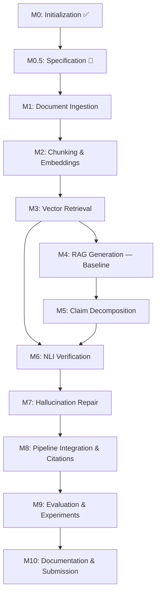

# Milestones

## Overview

This document defines the implementation milestones from project initialization through final evaluation. Each milestone has explicit dependencies, deliverables, and exit criteria.

**Status legend:** ✅ Complete | 🔄 In Progress | ⬜ Not Started

---

## Milestone 0 — Project Initialization

**Status:** ✅ Complete

**Deliverables:**
- Repository structure (backend, frontend, docs, scripts, data).
- FastAPI application scaffold with health endpoint.
- React + Vite + TypeScript frontend scaffold.
- PostgreSQL Docker Compose configuration.
- SQLAlchemy async engine with lazy initialization.
- LLM provider abstraction (`LLMProvider` interface).
- pytest configuration.
- Environment variable template (`.env.example`).

**Exit Criteria:**
- [x] `uvicorn app.main:app --reload` starts without errors.
- [x] `GET /api/health` returns `{"status": "healthy"}`.
- [x] Frontend `npm run dev` starts without errors.
- [x] LLM provider interface is defined and importable.

---

## Milestone 0.5 — Engineering Specification

**Status:** ✅ Complete

**Dependencies:** Milestone 0

**Deliverables:**
- `docs/PRD.md` — Product requirements.
- `docs/ARCHITECTURE.md` — System architecture and data flow.
- `docs/MILESTONES.md` — This document.
- `docs/API_SPECIFICATION.md` — Planned REST API contracts.
- `docs/DATABASE_DESIGN.md` — Planned database schema.
- `docs/RESEARCH_PLAN.md` — Research objectives and experiments.
- `docs/EVALUATION_PLAN.md` — Evaluation methodology.
- `docs/MODEL_SELECTION.md` — Model selection rationale.
- `docs/TEAM_RESPONSIBILITIES.md` — Team member responsibilities.
- `docs/adr/001-llm-selection.md` — ADR: LLM selection.
- `docs/adr/002-vector-store.md` — ADR: Vector store.
- `docs/adr/003-verification-strategy.md` — ADR: Verification strategy.
- `docs/adr/004-repair-strategy.md` — ADR: Repair strategy.

**Exit Criteria:**
- [x] All documentation files created and internally consistent.
- [x] Technology stack is consistent across all documents.
- [x] Research questions map to measurable evaluation metrics.
- [x] API contracts align with the pipeline architecture.
- [x] Database schema supports all pipeline stages.

---

## Milestone 1 — Document Ingestion

**Status:** ✅ Complete

**Dependencies:** Milestone 0.5

**Deliverables:**
- `DocumentProcessor` interface and PyMuPDF implementation.
- PDF upload API endpoint (`POST /api/v1/documents`).
- Text extraction with page-level metadata.
- `Document` and `Page` database models and migrations.
- Document metadata API (`GET /api/v1/documents`, `GET /api/v1/documents/{id}`).
- File storage to local filesystem under `data/documents/`.
- Unit tests for extraction and upload.

**Exit Criteria:**
- [x] A PDF can be uploaded via the API.
- [x] Extracted text preserves page boundaries.
- [x] Document and page records are persisted in PostgreSQL.
- [x] Document list and detail endpoints return correct data.
- [x] Tests pass for extraction of a multi-page PDF.

**Owner:** Member 3 (Harshal) — API, database, storage. Member 1 — extraction integration.

---

## Milestone 2 — Chunking and Embeddings

**Status:** 🔄 In Progress

**Dependencies:** Milestone 1

**Deliverables:**
- `ChunkingStrategy` interface and page-boundary-respecting implementation (chunks do not cross page breaks for MVP).
- `EmbeddingProvider` interface and Sentence Transformers implementation (BGE-small).
- `Chunk` database model and migration.
- Chunk records persisted with page references.
- Embedding generation for all chunks of a document.
- Unit tests for chunking logic and embedding dimensions.

**Exit Criteria:**
- [ ] Uploaded document is chunked with page metadata preserved.
- [ ] Chunk records are persisted in PostgreSQL.
- [ ] Embeddings are generated with correct dimensionality for BGE-small (384).
- [ ] Chunking parameters (size, overlap) are configurable.
- [ ] Tests validate chunk boundaries do not cross page breaks.

**Owner:** Member 1 — chunking, embeddings. Member 3 (Harshal) — database models, repository layer.

---

## Milestone 3 — Vector Retrieval

**Status:** ⬜ Not Started

**Dependencies:** Milestone 2

**Deliverables:**
- `RetrievalProvider` interface and FAISS implementation.
- FAISS index creation from chunk embeddings.
- Index persistence to filesystem.
- Retrieval API endpoint (`POST /api/v1/queries/retrieve`).
- Top-K retrieval with similarity scores and page metadata.
- Retrieval evaluation: Recall@K, Precision@K, MRR on test queries.

**Exit Criteria:**
- [ ] FAISS index is built from document embeddings.
- [ ] Retrieval returns top-K chunks with page references and scores.
- [ ] Retrieval metrics are measured on at least one test document set.
- [ ] Index survives application restart (persisted to disk).

**Owner:** Member 1 — retrieval implementation and experiments. Member 3 (Harshal) — API endpoint.

---

## Milestone 4 — RAG Generation (Baseline)

**Status:** ⬜ Not Started

**Dependencies:** Milestone 3

**Deliverables:**
- Ollama `LLMProvider` implementation.
- RAG prompt template (question + retrieved context → answer).
- Query API endpoint (`POST /api/v1/queries`).
- `Query` and `QueryResult` database models.
- Pipeline run persistence.
- Standard RAG baseline evaluation.
- Frontend: basic query input and answer display.

**Exit Criteria:**
- [ ] A question against an uploaded document produces a generated answer.
- [ ] The answer includes the retrieved context used for generation.
- [ ] Baseline RAG metrics are recorded for comparison.
- [ ] Pipeline run is persisted in the database.
- [ ] Frontend displays the answer.

**Owner:** Member 1 — RAG experiments, prompt design. Member 3 (Harshal) — API, database, Ollama integration. Member 4 — frontend query UI.

---

## Milestone 5 — Claim Decomposition

**Status:** ⬜ Not Started

**Dependencies:** Milestone 4

**Deliverables:**
- `ClaimDecomposer` interface and LLM-based implementation.
- Prompt engineering for atomic claim extraction.
- `Claim` database model.
- Claims returned as structured output from the pipeline.
- Manual evaluation of decomposition quality on sample outputs.

**Exit Criteria:**
- [ ] Generated answers are decomposed into atomic claims.
- [ ] Claims are individually addressable (stored with IDs and parent reference).
- [ ] Manual review confirms claims are atomic and coherent.
- [ ] Decomposition does not lose information from the original answer.

**Owner:** Member 2 — claim decomposition, prompt design, evaluation.

---

## Milestone 6 — NLI Verification

**Status:** ⬜ Not Started

**Dependencies:** Milestone 5, Milestone 3

**Deliverables:**
- `VerificationProvider` interface and NLI model implementation.
- Evidence retrieval per claim (reuses retrieval service).
- Claim–evidence verification producing supported / contradicted / unverifiable labels.
- `VerificationResult` database model.
- Verification precision/recall/F1 evaluation.
- Frontend: per-claim verification status display.

**Exit Criteria:**
- [ ] Each claim is verified against retrieved evidence.
- [ ] Classification labels are persisted per claim.
- [ ] Unverifiable claims are not treated as false.
- [ ] Verification metrics are measured against human-annotated samples.
- [ ] Frontend displays per-claim labels.

**Owner:** Member 2 — NLI integration, verification evaluation. Member 3 (Harshal) — database models, service integration. Member 4 — frontend evidence display.

---

## Milestone 7 — Hallucination Repair

**Status:** ⬜ Not Started

**Dependencies:** Milestone 6

**Deliverables:**
- `RepairStrategy` interface and LLM-based evidence-constrained implementation.
- Targeted repair of contradicted claims using source evidence.
- Additional evidence retrieval for unverifiable claims; no fabrication when evidence is insufficient.
- Re-verification of repaired claims using the verification service.
- Repair iteration cap to prevent infinite loops.
- `RepairAction` database model.
- Repair success rate and collateral modification rate measurement.

**Exit Criteria:**
- [ ] Only contradicted claims are sent for repair; unverifiable claims trigger additional evidence retrieval first.
- [ ] Supported claims are not modified.
- [ ] Repaired claims are re-verified before inclusion.
- [ ] Repair loop terminates within a bounded number of iterations.
- [ ] Repair and collateral modification metrics are measured.

**Owner:** Member 3 (Harshal) — repair implementation, re-verification loop, pipeline orchestration.

---

## Milestone 8 — Pipeline Integration and Citations

**Status:** ⬜ Not Started

**Dependencies:** Milestone 7

**Deliverables:**
- `PipelineOrchestrator` — end-to-end query → answer with citations.
- Final answer assembly with per-claim source and page citations.
- Full pipeline run persistence (all intermediate results).
- Pipeline detail API (`GET /api/v1/queries/{id}/pipeline`).
- Frontend: full evidence visualization with citations.

**Exit Criteria:**
- [ ] End-to-end pipeline executes: query → retrieval → generation → decomposition → verification → repair → re-verification → cited answer.
- [ ] Final answer includes page-level citations.
- [ ] All intermediate results are persisted and queryable.
- [ ] Frontend displays the complete pipeline output.

**Owner:** Member 3 (Harshal) — pipeline orchestration, API. Member 4 — frontend evidence/citation UI.

---

## Milestone 9 — Evaluation and Experiments

**Status:** ⬜ Not Started

**Dependencies:** Milestone 8

**Deliverables:**
- Baseline vs. proposed system comparison.
- Evaluation across all defined metrics (see [EVALUATION_PLAN.md](EVALUATION_PLAN.md)).
- Experimental results for all four research questions.
- Latency and computational overhead measurement.
- Evaluation report.

**Exit Criteria:**
- [ ] All research questions are addressed with experimental evidence.
- [ ] Baseline (standard RAG) and proposed system are compared on the same test set.
- [ ] Results are reported honestly; no fabricated metrics.
- [ ] Latency breakdown per pipeline stage is documented.

**Owner:** All members per their evaluation scope (see [TEAM_RESPONSIBILITIES.md](TEAM_RESPONSIBILITIES.md)).

---

## Milestone 10 — Documentation and Submission

**Status:** ⬜ Not Started

**Dependencies:** Milestone 9

**Deliverables:**
- Final project report.
- Updated README with final status.
- Code cleanup and documentation.
- Reproducibility instructions.

**Exit Criteria:**
- [ ] All documentation is consistent with the final implementation.
- [ ] The project can be set up and run from the README instructions.
- [ ] Experimental results are reproducible.

**Owner:** All members.

---

## Milestone Dependency Graph

