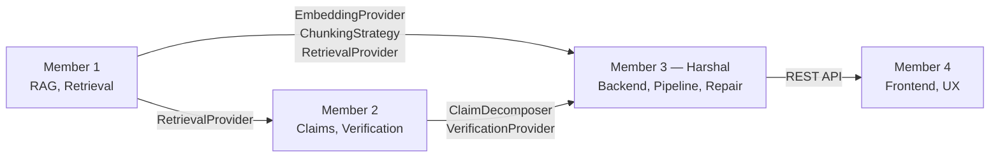

# Team Responsibilities

## 1. Members and Primary Domains

| Member | Primary Domain |
|--------|---------------|
| **Member 1** | RAG pipeline: embeddings, retrieval, generation, retrieval experiments. |
| **Member 2** | Verification pipeline: claim decomposition, NLI verification, hallucination detection, verification evaluation. |
| **Member 3 (Harshal)** | Backend infrastructure: FastAPI, database, API contracts, service integration, pipeline orchestration, hallucination repair, re-verification, backend testing. |
| **Member 4** | Frontend: React UI, UX design, evidence visualization, frontend evaluation interface. |

## 2. Detailed Responsibilities

### Member 1 — RAG, Embeddings, Retrieval

| Responsibility | Deliverables |
|---------------|-------------|
| Embedding pipeline | `EmbeddingProvider` interface implementation with Sentence Transformers (BGE-small). |
| Chunking strategy | `ChunkingStrategy` implementation for page-aware chunking. |
| Retrieval implementation | `RetrievalProvider` implementation with FAISS. Index creation, persistence, and search. |
| RAG generation | RAG prompt design. Prompt templates for question + context → answer. |
| Retrieval experiments | Evaluate Recall@K, Precision@K, MRR across different parameters. |
| Baseline evaluation | Run and measure standard RAG baseline metrics. |

**Interface with Member 3 (Harshal):** Member 1 implements service logic (embedding, chunking, retrieval). Member 3 creates the database models, repository layer, and API endpoints that expose these services.

**Interface with Member 2:** Member 1's retrieval service is reused by Member 2 for evidence retrieval per claim during verification.

---

### Member 2 — Claim Decomposition, Verification

| Responsibility | Deliverables |
|---------------|-------------|
| Claim decomposition | `ClaimDecomposer` implementation. Prompt design for extracting atomic claims from generated text. |
| NLI integration | `VerificationProvider` implementation with the selected NLI model. |
| Verification logic | Claim–evidence pairing, NLI inference, three-way classification (supported / contradicted / unverifiable). |
| Verification evaluation | Measure verification precision, recall, F1 against human-annotated ground truth. |
| Hallucination detection analysis | Analyze types and frequency of hallucinations in baseline vs. proposed system. |

**Interface with Member 3 (Harshal):** Member 2 implements the `ClaimDecomposer` and `VerificationProvider` service logic. Member 3 integrates these into the pipeline orchestrator and creates the database models (`claims`, `claim_evidence`) and API layer.

**Interface with Member 1:** Member 2 uses Member 1's `RetrievalProvider` to retrieve evidence for each claim.

---

### Member 3 (Harshal) — Backend, Pipeline, Repair

| Responsibility | Deliverables |
|---------------|-------------|
| Backend architecture | FastAPI application structure. Layer separation (API → Services → Repositories → Models). |
| Database design | SQLAlchemy ORM models. Alembic migrations. Database schema. |
| API contracts | REST endpoints per [API_SPECIFICATION.md](API_SPECIFICATION.md). Request/response validation with Pydantic. |
| Service integration | Wire all service implementations (from Members 1 and 2) into the backend. Dependency injection. |
| Pipeline orchestration | `PipelineOrchestrator` — end-to-end pipeline: retrieval → generation → decomposition → verification → repair → re-verification → citation assembly. |
| Hallucination repair | `RepairStrategy` implementation. Evidence-constrained targeted repair of contradicted claims. Unverifiable claim handling (additional evidence retrieval; flagging when evidence is insufficient). |
| Re-verification | Re-verification loop after repair. Bounded iteration. |
| Backend testing | pytest tests for API endpoints, services, and pipeline integration. |
| Performance measurement | Per-stage latency instrumentation. Pipeline run timing. |

**Interface with Member 1:** Member 3 creates database models and API endpoints for documents, chunks, and queries. Member 1 provides the service-layer implementations for embedding, chunking, and retrieval.

**Interface with Member 2:** Member 3 creates database models for claims and verification results, and integrates Member 2's `ClaimDecomposer` and `VerificationProvider` into the pipeline.

**Interface with Member 4:** Member 3 defines the API contracts that Member 4's frontend consumes. Any API changes are coordinated between them.

---

### Member 4 — Frontend, UX, Visualization

| Responsibility | Deliverables |
|---------------|-------------|
| UI implementation | React + TypeScript + Vite application. |
| Document upload | File upload UI with progress and status feedback. |
| Query interface | Question input, document selection, answer display. |
| Evidence visualization | Per-claim verification status display (supported / contradicted / unverifiable). Evidence passage display with page citations. |
| Repair visualization | Show original vs. repaired claims. |
| Evaluation interface | UI for viewing pipeline run details, metrics, and comparison between baseline and proposed system. |
| Frontend testing | Component and integration tests. |

**Interface with Member 3 (Harshal):** Member 4 consumes the REST API defined by Member 3. API contract changes require coordination.

---

## 3. Shared Responsibilities

| Responsibility | Members |
|---------------|---------|
| Dataset curation | All |
| Human annotation for evaluation | All |
| Final report writing | All |
| Code review | All (cross-review between domains) |
| Documentation maintenance | Each member updates docs relevant to their domain |

## 4. Integration Points

**Contract:** Each interface (`LLMProvider`, `EmbeddingProvider`, `RetrievalProvider`, `ClaimDecomposer`, `VerificationProvider`, `RepairStrategy`) defines the boundary between members. Members implement the interface; the pipeline orchestrator (Member 3) consumes it.

## 5. Evaluation Ownership

| Evaluation Category | Primary Owner | Supporting |
|--------------------|--------------|-----------|
| Retrieval (Recall@K, Precision@K, MRR) | Member 1 | — |
| Generation (hallucination rate, baseline comparison) | Member 1 (baseline), Member 2 (proposed) | Member 3 |
| Verification (precision, recall, F1) | Member 2 | — |
| Repair (success rate, collateral modification) | Member 3 (Harshal) | — |
| Citation (coverage, precision) | Member 3 (Harshal) | Member 4 |
| Performance (latency, overhead) | Member 3 (Harshal) | — |
| Human annotation | All | — |

## 6. Cross-References

- Milestone ownership: [MILESTONES.md](MILESTONES.md)
- Evaluation plan: [EVALUATION_PLAN.md](EVALUATION_PLAN.md)
- API contracts: [API_SPECIFICATION.md](API_SPECIFICATION.md)
- Architecture and service interfaces: [ARCHITECTURE.md](ARCHITECTURE.md)
